# Diagramas de Gearly 1.0

Diagramas del documento de trabajo de grado, actualizados el 20 de noviembre de 2026 para reflejar la versión 1.0 del repositorio. Cada diagrama está escrito en Mermaid: GitHub lo dibuja en esta página y el archivo `.mmd` se puede abrir y editar en https://mermaid.live. Junto a cada uno está la imagen PNG que se usa en el documento.

## 1. Contexto (C4, nivel 1)

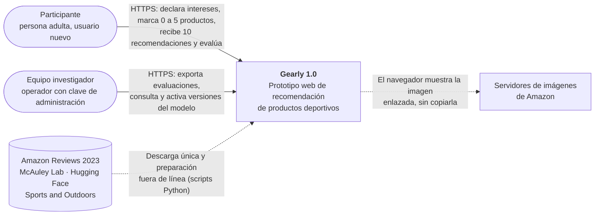

Imagen: [01_contexto.png](01_contexto.png) · Fuente: [01_contexto.mmd](01_contexto.mmd)

## 2. Contenedores (C4, nivel 2)

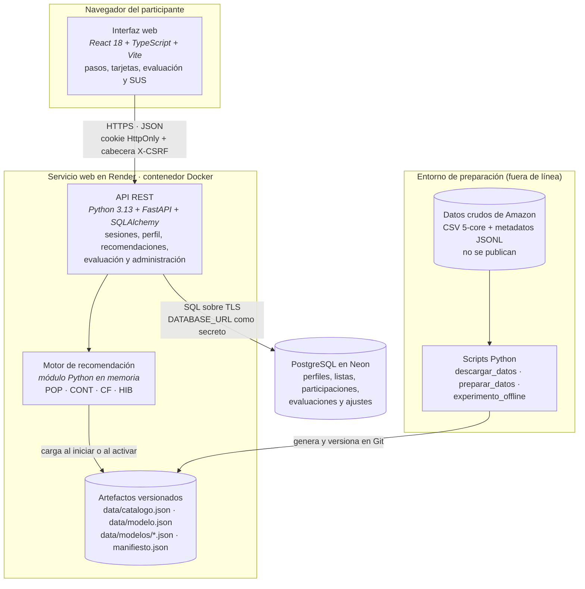

Imagen: [02_contenedores.png](02_contenedores.png) · Fuente: [02_contenedores.mmd](02_contenedores.mmd)

## 3. Componentes de la API y del motor de recomendación (C4, nivel 3)

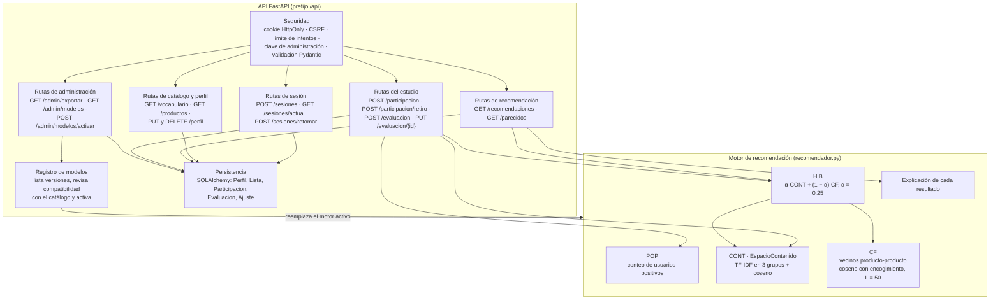

Imagen: [03_componentes_api.png](03_componentes_api.png) · Fuente: [03_componentes_api.mmd](03_componentes_api.mmd)

## 4. Modelo de datos operativo (entidad-relación, PostgreSQL)

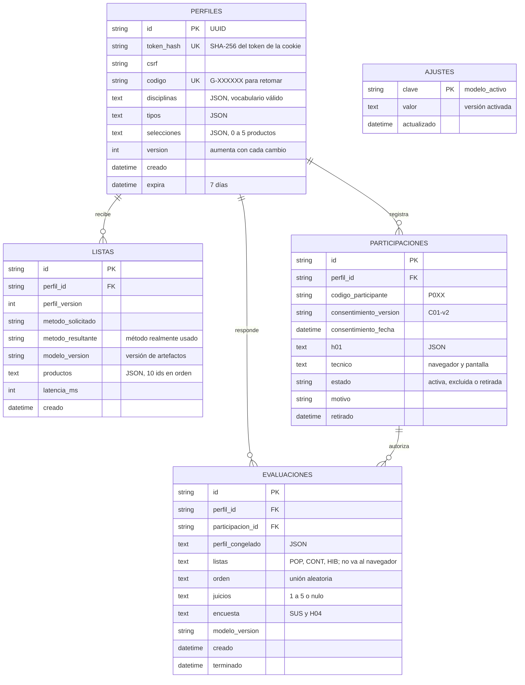

Imagen: [04_modelo_datos.png](04_modelo_datos.png) · Fuente: [04_modelo_datos.mmd](04_modelo_datos.mmd)

## 5. Artefactos del modelo y su versión

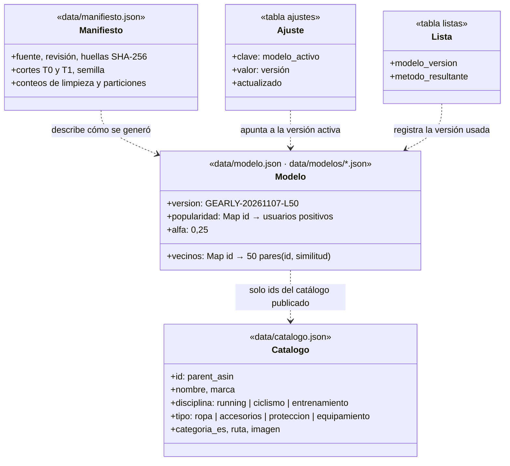

Imagen: [05_artefactos.png](05_artefactos.png) · Fuente: [05_artefactos.mmd](05_artefactos.mmd)

## 6. Preparación de datos, particiones y experimento offline

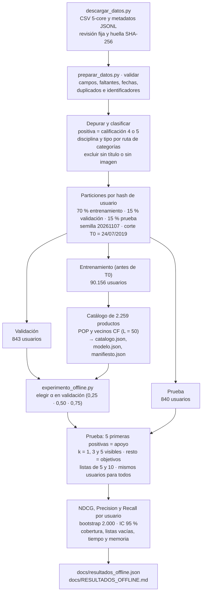

Imagen: [06_preparacion_datos.png](06_preparacion_datos.png) · Fuente: [06_preparacion_datos.mmd](06_preparacion_datos.mmd)

## 7. Secuencia de una recomendación

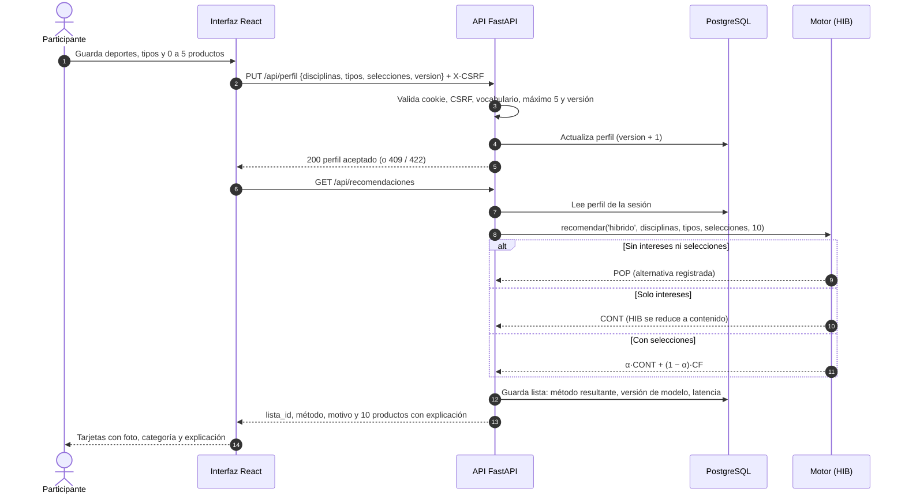

Imagen: [07_secuencia_recomendacion.png](07_secuencia_recomendacion.png) · Fuente: [07_secuencia_recomendacion.mmd](07_secuencia_recomendacion.mmd)

## 8. Flujo de primer uso y evaluación

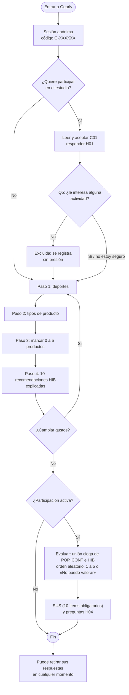

Imagen: [08_flujo_uso_evaluacion.png](08_flujo_uso_evaluacion.png) · Fuente: [08_flujo_uso_evaluacion.mmd](08_flujo_uso_evaluacion.mmd)

## 9. Despliegue

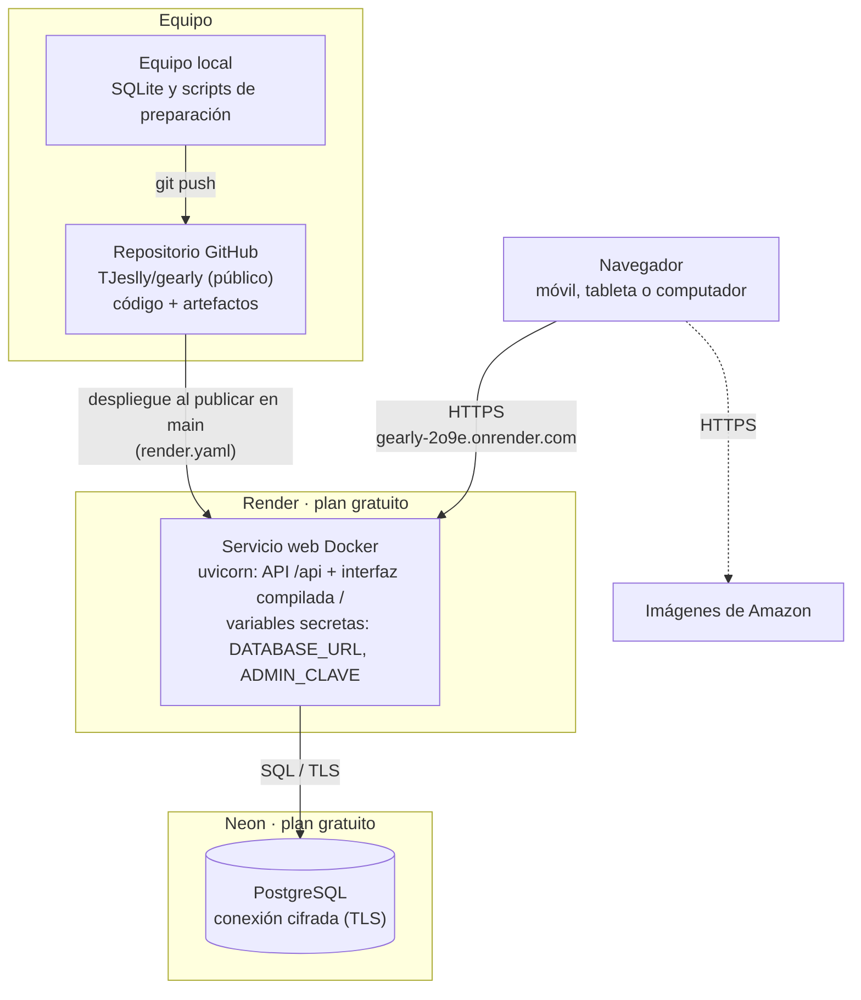

Imagen: [09_despliegue.png](09_despliegue.png) · Fuente: [09_despliegue.mmd](09_despliegue.mmd)

## 10. Procedimiento para activar una nueva versión del modelo

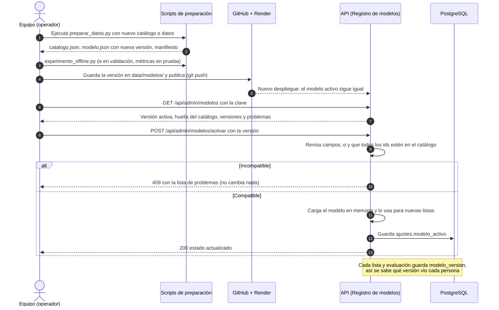

Imagen: [10_activacion_modelo.png](10_activacion_modelo.png) · Fuente: [10_activacion_modelo.mmd](10_activacion_modelo.mmd)

## 11. Casos de uso (UML)

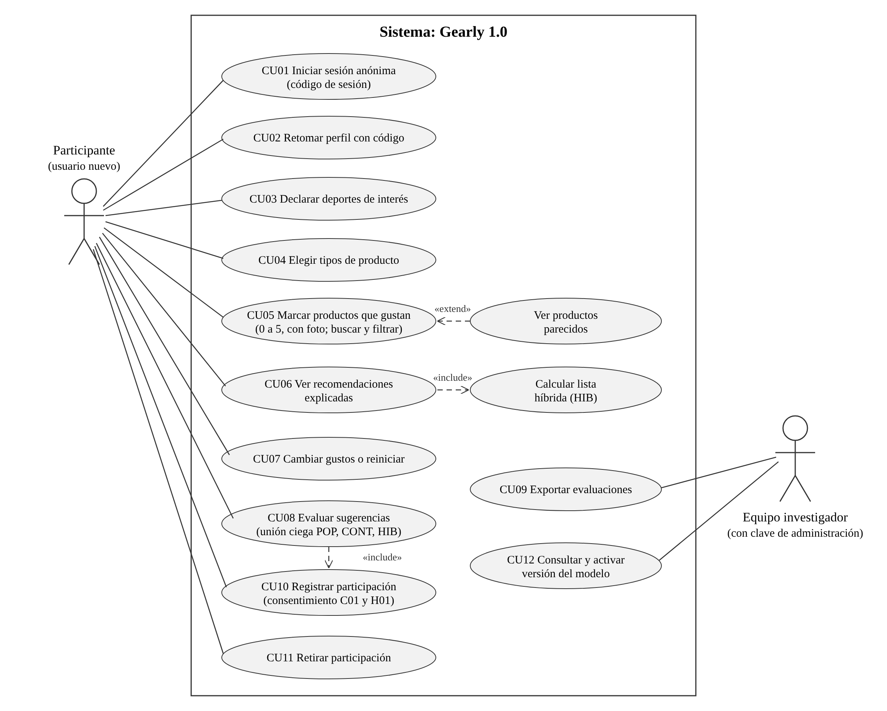

Fuente editable: [11_casos_uso.svg](11_casos_uso.svg).

## 12. Diagrama de clases (UML)

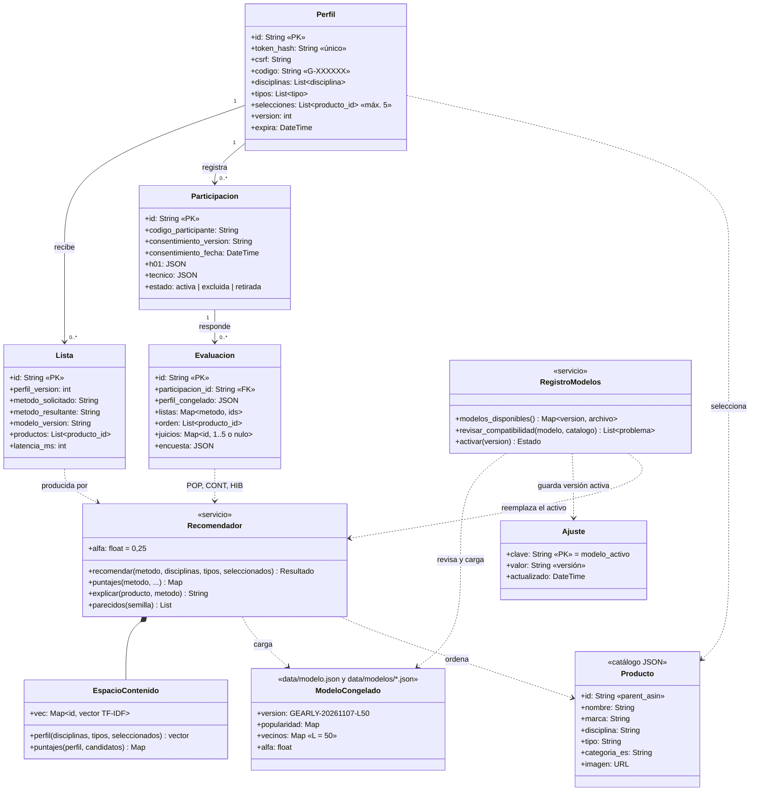

Imagen: [12_clases.png](12_clases.png) · Fuente: [12_clases.mmd](12_clases.mmd)
